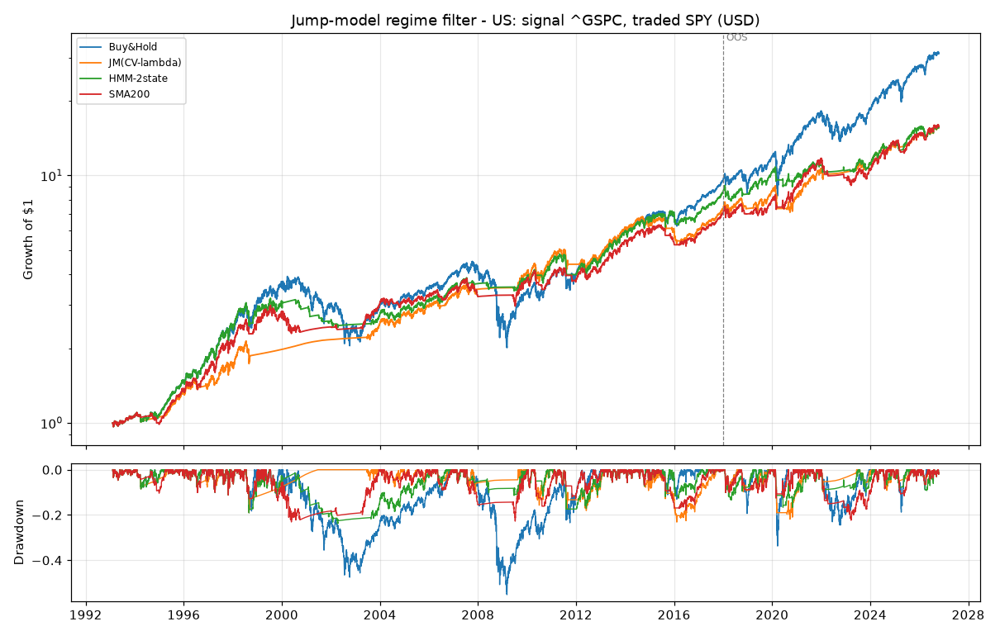
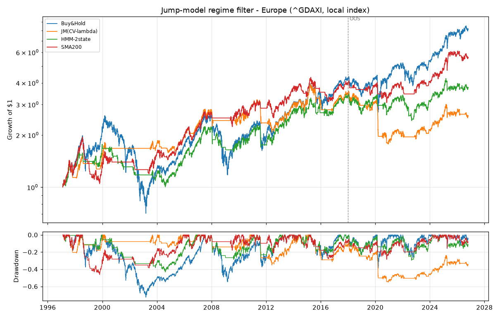
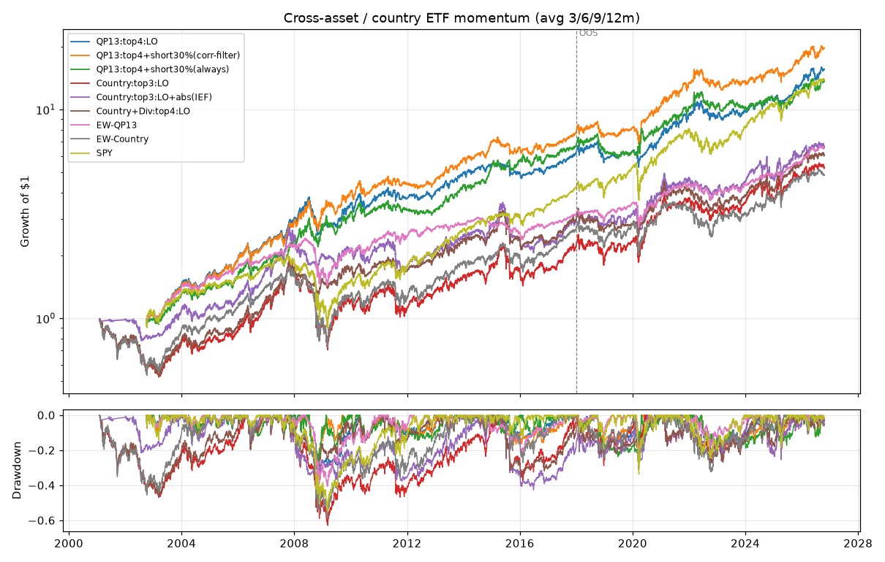
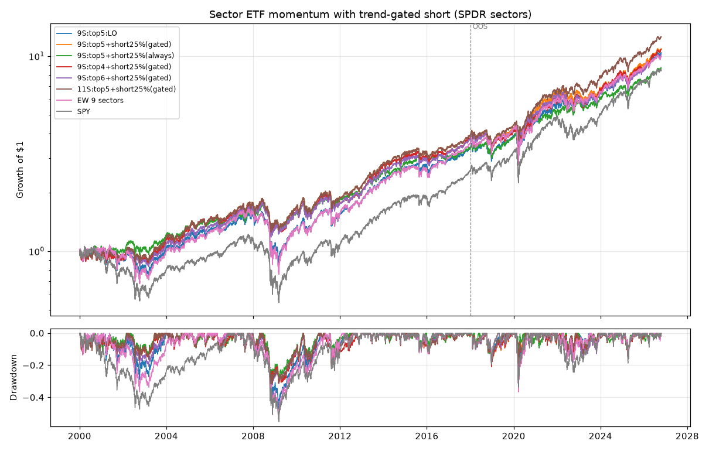
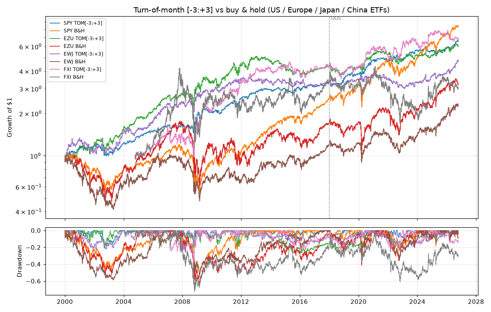
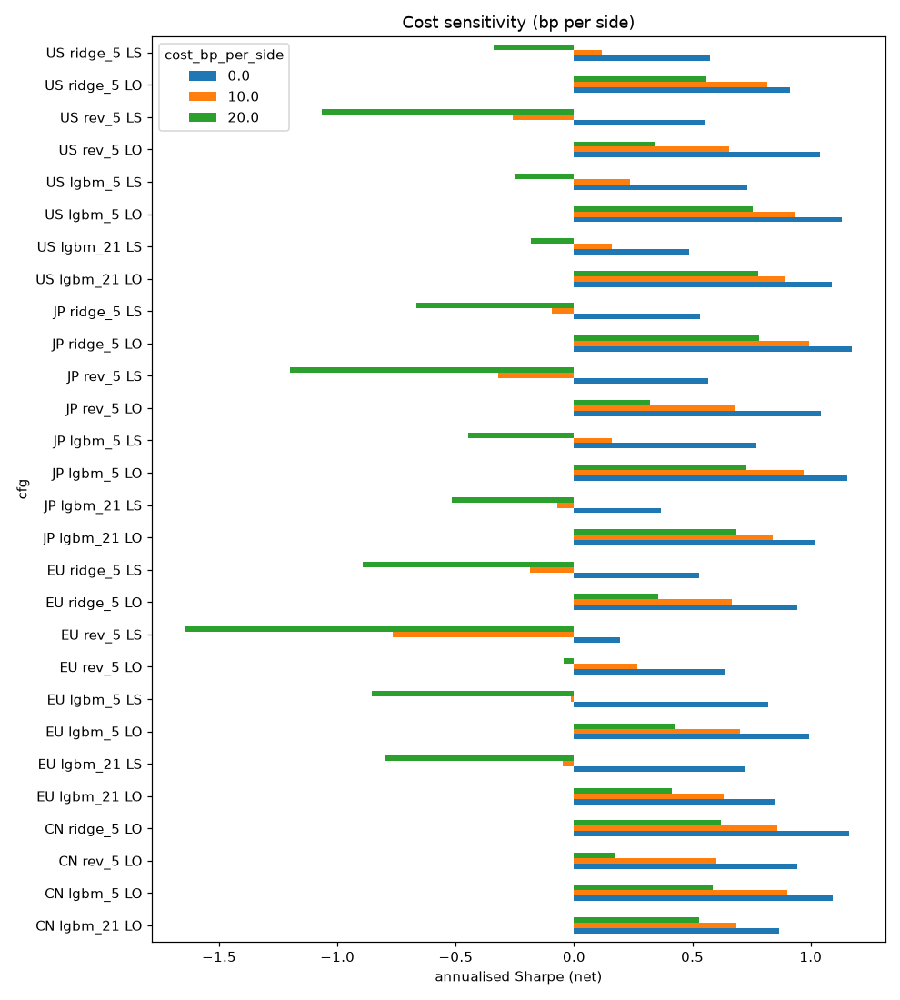
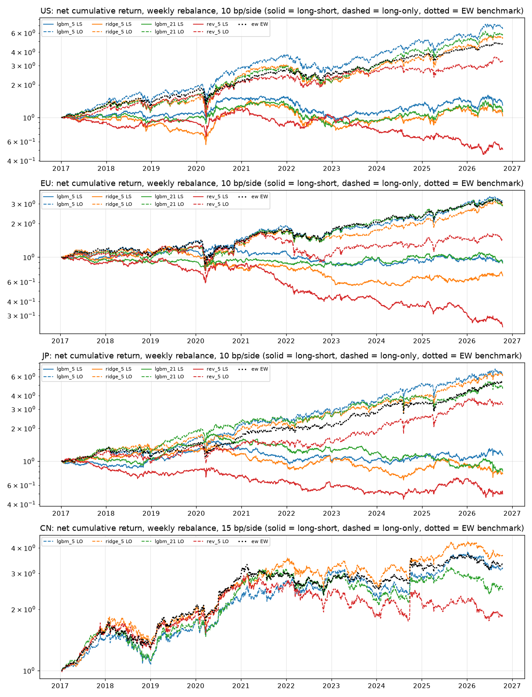
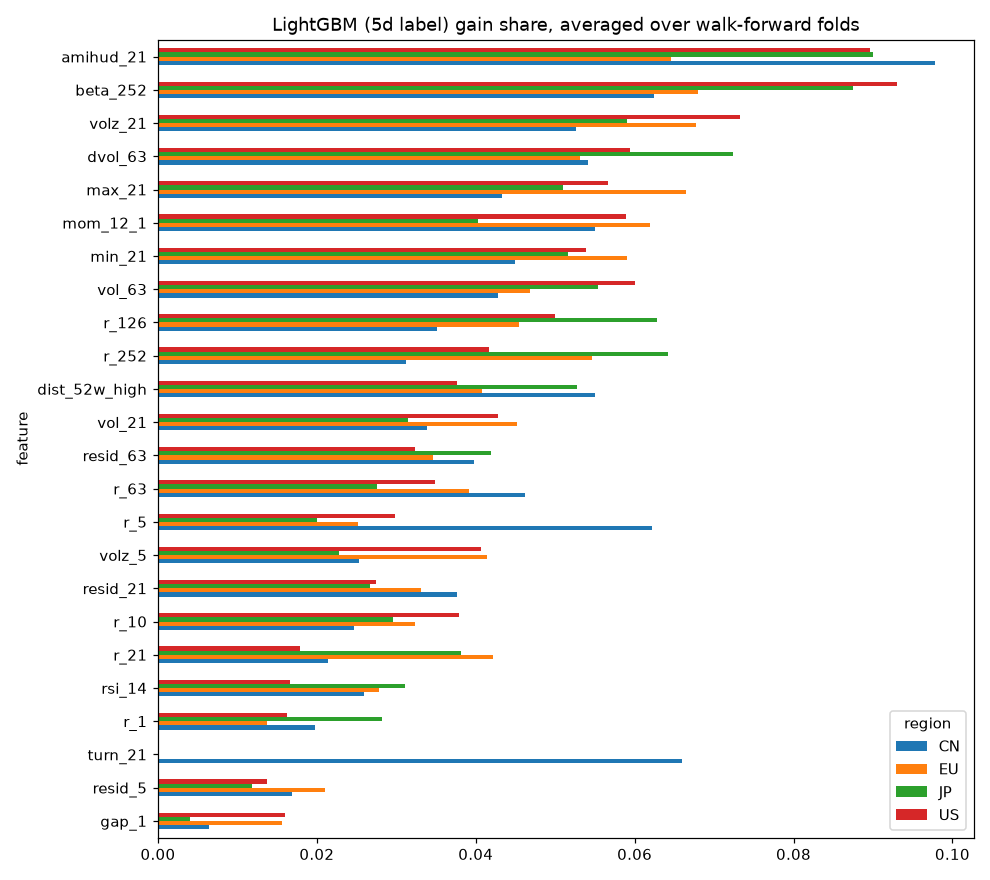

# Costs and deflation erase most new edges

None of the roughly 130 strategy variants we built from the 2023–2026 literature shows a statistically reliable edge over its own benchmark once it is backtested on free data with the ML4T libraries, charged realistic costs, and deflated for the number of variants tried. The literature itself points this way: the published results that survive costs are slow and low-turnover (regime filters, diversified trend, monthly momentum with filters). The headline ML results (gross Sharpe ratios of 5 to 7 from daily cross-sectional CatBoost, Chronos or LLM-headline signals) come from small caps, daily rebalancing and zero costs. Our rules-based backtests across US, European, Japanese and Chinese indices and ETFs reproduce what these overlays are usually sold for, which is **drawdown control and not alpha**. The statistical jump model cut SPY's maximum drawdown from −55% to −23% at a slightly higher Sharpe (0.56 vs 0.51), but it **lost to buy-and-hold out of sample in every non-US market**. The best absolute performer, Quantpedia-style cross-asset ETF momentum (Sharpe 0.73–0.77), has an active deflated Sharpe probability of only 0.40. Our ML cross-sectional models (LightGBM and Ridge on 24 price/volume features, weekly rebalance, 40–50 large caps per region) found a **real but small out-of-sample rank IC of 0.016–0.029** (Newey-West t 2.3–3.5) in all four regions. About 45–55× annual turnover then turns long-short gross Sharpe ratios of 0.5–0.8 into **negative numbers at 20 bp per side**. The ML4T stack (ml4t-backtest 0.1.12, ml4t-diagnostic 0.1.9, ml4t-engineer 0.1.6) ran natively on Windows under Python 3.13 without zipline, and both pipelines rerun with one command each.

## Recent research rewards slow signals and punishes fast ones

### Machine-learning strategies: big gross numbers, little that survives costs

The most reproducible new ML strategy is the **statistical jump model (JM) regime filter** of Shu, Yu and Mulvey. It is a two-state clustering model with a penalty on regime switches, fed with three features: EWM downside deviation (halflife 10 days) and EWM Sortino ratios (halflives 20 and 60). The portfolio holds the index in the bull state and T-bills in the bear state, with 10 bp per trade. Over 1990–2023 it reported a Sharpe of **0.68 vs 0.48 for US buy-and-hold, 0.44 vs 0.30 for Germany and 0.31 vs 0.12 for Japan**, and it beat a Gaussian HMM baseline in each market ([arXiv 2402.05272](https://arxiv.org/html/2402.05272v2)). The Oxford-Man deep trend line is the other family published net of costs, but on futures. X-Trend uses few-shot cross-attention over past regimes ([arXiv 2310.10500](https://arxiv.org/html/2310.10500v2)). DeePM (January 2026) reports a **normalised out-of-sample net Sharpe of 0.93** on 50 futures and finds that training with half the true cost improves net performance by about 50% ([arXiv 2601.05975](https://arxiv.org/pdf/2601.05975)).

Daily cross-sectional ML looks spectacular and fragile. Rahimikia, Ni and Wang report **CatBoost long-short Sharpe 6.79** on about 10,000 US stocks, with daily rebalancing "without accounting for transaction costs". In the same study, zero-shot Chronos and TimesFM forecasts have negative out-of-sample R² ([arXiv 2511.18578](https://arxiv.org/html/2511.18578v1)). Valeyre and Aboura show that Chronos forecasts on residual returns become highly correlated with plain short-term reversal and fail to beat it. They conclude that AI does not yet find opportunities profitable after costs ([arXiv 2412.09394](https://arxiv.org/pdf/2412.09394)). A June 2026 study calls time-series foundation models "useful practical priors" rather than reliable alpha engines ([arXiv 2606.27100](https://arxiv.org/html/2606.27100)). The GPT-4 headline strategy of Lopez-Lira and Tang has decayed fast, from a Sharpe of **6.54 in 2021Q4 to 1.22 in January–May 2024** ([arXiv 2304.07619](https://arxiv.org/pdf/2304.07619)).

The strongest counter-evidence needs fundamentals. Azevedo, Hoegner and Velikov find that an LSTM combining 137 published anomalies earns **1.42% per month net of effective-spread costs** after 2005 (t = 3.99) ([AFA PDF](https://afajof.org/management/viewp.php?n=75544)). Jensen, Kelly, Malamud and Pedersen argue for learning portfolio weights directly from a net-of-cost objective, because cost-blind forecasts over-weight short-lived signals ([SFI](https://www.sfi.ch/en/publications/machine-learning-and-the-implementable-efficient-frontier)). Deep reinforcement learning and GNN papers from 2025–2026 are the weakest family: risk is stabilised but profitability is lost ([arXiv 2511.11481](https://arxiv.org/html/2511.11481v1)), and all GNN long-short portfolios are negative ([arXiv 2605.19278](https://arxiv.org/html/2605.19278v1)).

### Rules-based strategies: trend persists at lower Sharpe, fast anomalies decay

Among rules-based strategies, the strongest recent out-of-sample evidence is for diversified, volatility-normalised trend following. Sepp and Lucic test EWMA, breakout and TSMOM systems on 84 futures and report **net Sharpe ratios of 0.47–0.55 over 2000–2026**, statistically indistinguishable from the SG Trend Index ([arXiv 2607.19497](https://arxiv.org/abs/2607.19497)). That is roughly the reduced post-2009 level of naive TSMOM ([arXiv 2106.08420](https://arxiv.org/pdf/2106.08420)). Quantpedia published two code-ready ETF rotations:

- cross-asset momentum on 13 ETFs: top 4, plus a 30% short in the bottom ETF switched on by a correlation filter ([Quantpedia 2025](https://quantpedia.com/refining-etf-asset-momentum-strategy/));
- nine-sector momentum: top 5, plus a 25% short gated by the market's 12-month moving average, with Sharpe ratios of about 0.60–0.72 in sample ([Quantpedia 2024](https://quantpedia.com/how-to-improve-etf-sector-momentum/)).

The evidence on turn-of-month (TOM) conflicts. QuantSeeker finds the classic US [0:+3] window has largely disappeared while [-3:+3] remains significant in most markets ([QuantSeeker](https://www.quantseeker.com/p/turn-of-the-month-strategies-do-they)). Kayacetin finds about 10 bp/day across 30 markets that "comes back in full force" in 2019–2023, everywhere except Japan ([SSRN 7201062](https://papers.ssrn.com/sol3/papers.cfm?abstract_id=7201062)).

The decay list is long. Dual Momentum has lagged SPY since publication ([Quanterlab](https://quanterlab.com/research/antonacci-s-dual-momentum-taken-apart-gate-relative-leg-and-blends-across-four-l)). In a replication of graph-clustering pairs trading, Sharpe collapses from 1.17 to 0.28 at 5 bp costs ([arXiv 2406.10695](https://arxiv.org/pdf/2406.10695)). Overnight drift has weakened since its publication ([Elm Wealth](https://elmwealth.com/night-moves-overnight-drift/)). For context, factors replicate broadly (84.9% Bayesian replication rate globally) but are attenuated after publication ([NBER w28432](https://www.nber.org/system/files/working_papers/w28432/w28432.pdf)).

### Regional evidence: China is a reversal market, Japan a reform trade

Most of a **469-anomaly zoo fails in China A-shares** ([PolyU record of Li et al. 2024](https://ira.lib.polyu.edu.hk/handle/10397/115240)). The surviving signals are residual reversal and residual momentum ([Jansen, Swinkels and Zhou](https://pure.eur.nl/en/publications/anomalies-in-the-china-a-share-market/)), plus a short-term contrarian effect that Zhang and Zhu tie to the T+1 rule ([IDEAS](https://ideas.repec.org/a/eee/reveco/v96y2024ipbs1059056024006452.html)). An A-share backtest must model several market rules:

- T+1 settlement, so no same-day round trips;
- ±10% daily price limits, or ±20% on STAR and ChiNext ([SSE](https://english.sse.com.cn/start/trading/mechanism/));
- a seller-side stamp duty, **cut to 0.05% on 28 August 2023** ([gov.cn](https://english.www.gov.cn/policies/policywatch/202308/28/content_WS64ec5513c6d0868f4e8dee23.html)).

In Japan the main 2023–2026 story is the TSE capital-efficiency reform. Investors repriced persistently low-PBR, high-ROE firms without any change in their fundamentals ([ECGI WP 1038/2025](https://www.ecgi.global/publications/working-papers/investor-repricing-of-chronic-undervaluation-evidence-from-the-tokyo)). That makes it a fundamentals screen outside our price-only scope. In Europe the fresh peer-reviewed support is for cross-country factor momentum, which is positive in 140 of 145 anomalies ([Alpha Architect](https://alphaarchitect.com/cross-country-factor-momentum/)).

## A Python 3.13 venv runs the ML4T stack without zipline

The third edition of ML4T replaces zipline/alphalens/pyfolio with six Polars-based `ml4t-*` packages ([ml4trading.io/docs](https://www.ml4trading.io/docs/)). The book's notebook environment officially does not support native Windows Python ([book README](https://github.com/stefan-jansen/machine-learning-for-trading)), but the libraries ship pure-Python wheels for CPython 3.12–3.14. We therefore used a project venv at `.venv` on **Python 3.13.3** with:

- ml4t-backtest 0.1.12, ml4t-diagnostic 0.1.9, ml4t-engineer 0.1.6 and ml4t-data 0.2.1;
- lightgbm 4.7.0, polars 2.0, pandas 2.3.3, statsmodels 0.15, yfinance 1.7.0 and akshare 1.19.1;
- alphalens-reloaded and pyfolio-reloaded, installed but not needed;
- jumpmodels 0.1.1, the Shu/Yu/Mulvey group's implementation and the only package we added.

**We did not install zipline.** Its bcolz-zipline dependency has no Windows wheel for Python 3.13 ([PyPI](https://pypi.org/project/bcolz-zipline/)), and ml4t-backtest covers the same ground.

The APIs that worked, verified against the installed sources, were these:

| Need | Call that worked | Gotchas found |
|---|---|---|
| Event-driven backtest | `Engine(DataFeed(prices_df=pl_df), Strategy, BacktestConfig(...)).run()`, with `broker.rebalance_to_weights({...})` inside `on_data(self, timestamp, data, context, broker)` | Enums live in `ml4t.backtest.config` (`CommissionType`, `SlippageType`, `ShareType`, `ExecutionPrice`, `MissingPricePolicy`) and `ml4t.backtest.types` (`ExecutionMode`). A long/short book needs `allow_short_selling=True, allow_leverage=True`. Without the margin flag, 226 orders were rejected for insufficient cash and max drawdown diverged (−43% vs −33%). `NEXT_BAR` with a close-only feed fills at the next close. With `ExecutionPrice.OPEN` it fills at the next open. Idle cash earns no interest unless `funding_df` is used. The commission model sees unsigned quantity, so a sell-only stamp duty cannot be modelled. |
| Features | `ml4t.engineer.compute_features(pl_df, [{"name":"rsi",...}, {"name":"realized_volatility",...}, {"name":"downside_deviation","params":{"window":63}}], group_col="asset", timestamp_col="timestamp")` | `downside_deviation` takes `window`, not `period`. The catalog method is `describe()`, not `get()`. `amihud_illiquidity` uses close × volume, which is wrong for China back-adjusted prices, so we computed it in pandas. |
| Purged cross-validation | `WalkForwardCV(..., label_horizon=h+1, embargo_size=5, expanding=True, consecutive=True)` and `CombinatorialCV(n_groups=6, n_test_groups=2, ..., isolate_groups=False)` | Feed integer date indices. A naive DatetimeIndex raises `ValueError` because calendar mode needs tz-aware timestamps. |
| Signal evaluation | `ml4t.diagnostic.analyze_signal(factor, prices, periods=(1,5,21), quantiles=5)` | Takes 35–40 s per signal. Its IC t-stats treat overlapping horizons as independent and are inflated by about √5. |
| Overfitting control | `ml4t.diagnostic.evaluation.stats.deflated_sharpe_ratio(list_of_arrays, frequency="daily", effective_trials=K)` | Returns `.probability`, `.n_trials_effective` and related fields. `correlation_method="effective_rank"` also works. |
| Performance summary | `ml4t.diagnostic.integration.portfolio_analysis_from_result(result).compute_summary_stats()` | Works. `generate_tearsheet_from_result` needs the `viz` extra and was not used. |

We checked the engine against our own vectorised simulators. On the rules side the match was close: **daily return correlation 0.9999 and tracking error 0.2%/yr**. The sector strategy produced identical CAGR (9.3%) and Sharpe (0.53) in both, and the jump model on SPY produced identical CAGR (6.9%) and Sharpe (0.48), both with zero interest on cash. On the ML side, Sharpe ratios agreed within about 0.07 for long-only books and 0.13 for high-turnover long-short books.

Data came from yfinance (`auto_adjust=True`) for the US, Europe and Japan. For China we used akshare's Sina endpoints: `stock_zh_a_daily` with back-adjusted (hfq) prices, and `sh000300` for the CSI 300 index. Yahoo's `000300.SS` returned a single row, and Eastmoney's `stock_zh_a_hist` disconnected from this machine.

## Rules-based overlays cut drawdowns but never beat their benchmarks

We built five rules-based strategy families and ran about 100 variants. Signals at close t trade at close t+1. Costs are 5 bp per side (10 bp for the jump model, as in the paper), and shorts pay a 25 bp/yr borrow fee. Sharpe ratios are measured in excess of T-bills. The in-sample period (IS) ends 2017-12-31, and the out-of-sample period (OOS) runs from 2018-01-01 to 2026-10-19 ([metrics_rules.csv](../strategies/rules/results/metrics_rules.csv)).

### The jump model works only in the US, and only as a risk overlay

| Market | Strategy | CAGR % | Vol % | Sharpe | MaxDD % | IS Sharpe | OOS Sharpe |
|---|---|---|---|---|---|---|---|
| US SPY (1993+) | Buy & hold | 10.8 | 18.5 | 0.51 | −55.2 | 0.45 | 0.67 |
| | **JM (CV-λ)** | 8.5 | 11.3 | **0.56** | **−23.1** | 0.56 | 0.57 |
| | HMM 2-state | 8.5 | 11.5 | 0.55 | −23.8 | 0.58 | 0.45 |
| | SMA200 | 8.6 | 11.8 | 0.54 | −23.1 | 0.52 | 0.60 |
| Europe ^GDAXI (1997+) | Buy & hold | 7.3 | 22.7 | 0.42 | −72.7 | 0.40 | 0.50 |
| | JM (CV-λ) | 3.2 | 13.7 | 0.30 | −55.0 | 0.50 | **−0.15** |
| | SMA200 | 5.9 | 14.5 | 0.47 | −46.2 | 0.51 | 0.37 |
| Europe EWG (1997+) | JM (CV-λ) | 4.2 | 15.8 | 0.20 | −53.1 | 0.42 | **−0.30** |
| Japan ^N225 (1990+) | Buy & hold | 1.5 | 23.7 | 0.18 | −81.8 | 0.04 | 0.67 |
| | JM (CV-λ) | 1.5 | 12.8 | 0.18 | −43.0 | 0.20 | 0.13 |
| | HMM | 1.9 | 16.3 | 0.20 | −64.5 | 0.12 | 0.44 |
| Japan EWJ (1996+) | JM (CV-λ) | 4.1 | 12.4 | 0.20 | −34.9 | 0.29 | −0.08 |
| China CSI 300 (2011-09+) | Buy & hold | 2.8 | 21.3 | 0.24 | −46.7 | 0.37 | 0.12 |
| | JM (CV-λ) | 3.1 | 11.8 | 0.32 | −31.4 | 0.97 | **−0.24** |
| China ASHR (2013-11+) | JM (CV-λ) | 5.8 | 14.7 | 0.33 | −31 | 0.97 | −0.11 |

**In the US the jump model did its job: it halved drawdowns and kept Sharpe.** It did not beat a plain 200-day moving-average filter, and it did not reproduce the paper's 0.68 vs 0.48 gap. In Europe, Japan and China it lost to buy-and-hold out of sample, often badly. On the DAX it earned −3.2%/yr against +7.9%/yr for buy-and-hold over 2018–2026, because it repeatedly switched out near lows and back in late. The jump penalty λ chosen by cross-validation was unstable outside the US: China picked λ = 5 in 73% of months, while Europe split between 5 and 100. The best fixed λ chosen afterwards also differs by market, which is exactly the multiple-testing trap. The simpler baselines held up better out of sample: SMA200 in Europe, and the HMM in Japan (0.44) and China. Some of the gap to the paper comes from our deviations: price indices without dividends, `n_init=5`, a coarse λ grid, λ selection from out-of-sample online labels rather than refits within the validation window, and 0% cash yield on local-currency indices.




### Trend, momentum and sector rotation: cross-asset momentum is the most stable

| Strategy | Start | CAGR % | Vol % | Sharpe | MaxDD % | Turnover/yr | IS Sharpe | OOS Sharpe |
|---|---|---|---|---|---|---|---|---|
| Trend EWMA 20/250, long-only, weekly (16 ETFs) | 2003 | 7.4 | 10.7 | 0.56 | −18.8 | 8.0 | 0.73 | 0.27 |
| Trend EWMA 20/250, long-short, daily | 2003 | 5.8 | 10.7 | 0.42 | −21.0 | 13.3 | 0.57 | 0.17 |
| Trend TSMOM 10×10, long-short, daily | 2003 | 1.7 | 10.6 | 0.05 | −26.4 | 36.0 | 0.17 | −0.16 |
| *60/40 SPY/IEF* | 2003 | 8.6 | 10.4 | 0.68 | −32.2 | 0.3 | 0.74 | 0.60 |
| **Momentum QP13 top-4 + 30% corr-filtered short** | 2002-10 | 13.2 | 15.5 | **0.77** | −28.8 | 6.6 | 0.87 | 0.59 |
| Momentum QP13 top-4, long-only | 2002-10 | 12.1 | 14.8 | 0.73 | −34.3 | 4.6 | 0.81 | 0.60 |
| Momentum country ETFs top-3 + abs-mom → IEF | 2001 | 7.7 | 19.2 | 0.39 | −42.8 | 6.9 | 0.36 | 0.43 |
| *EW QP13* | 2002-10 | 8.1 | 12.2 | 0.56 | −40.6 | 0.4 | 0.57 | 0.55 |
| **Sector 9S top-5 + 25% gated short** | 2000 | 9.3 | 15.5 | 0.53 | −33.0 | 3.7 | 0.47 | 0.66 |
| *EW 9 sectors* | 2000 | 9.0 | 18.1 | 0.46 | −53.6 | – | 0.39 | 0.60 |
| *SPY* | 2000 | 8.3 | 19.2 | 0.41 | −55.2 | – | 0.29 | 0.67 |

The ETF version of Sepp–Lucic trend roughly **halved its Sharpe out of sample** and never beat 60/40. Every region still contributed positively to its gross P&L, between 0.8 and 1.6%/yr each ([trend_region_contrib.csv](../strategies/rules/results/trend_region_contrib.csv)). Two things explain the shortfall against the futures paper's net Sharpe of about 0.5: our proxy holds only 16 ETFs (versus 84 futures) and is equity-heavy. Cross-asset momentum had the best absolute numbers and the smallest in-sample to out-of-sample drop (0.81–0.87 to 0.60). The correlation-filtered short added about 0.05 Sharpe in sample and nothing out of sample. Country momentum beat equal-weight countries but not SPY, because US dominance drives most of its return. Sector momentum with the gated short showed the cleanest consistency: out-of-sample Sharpe 0.66 vs 0.67 for SPY, with **out-of-sample max drawdown of −20% vs −34%**. We also found and fixed an easy-to-repeat bug: applying the 20/250 EWMAs to returns instead of to cumulative normalised returns produced about 100× annual turnover and a negative Sharpe.




### Turn-of-month survives in the US and China, fades in Europe and vanishes in Japan

| Instrument | Region | [-3:+3] in / out (bp/day) | t | OOS in / out (bp/day) | TOM Sharpe | B&H Sharpe | TOM OOS Sharpe |
|---|---|---|---|---|---|---|---|
| SPY | US | 8.9 / 1.4 | 2.46 | 9.2 / 4.6 | 0.53 | 0.41 | 0.54 |
| ^GDAXI | Europe | 9.5 / −0.4 | 2.74 | 5.3 / 2.9 | 0.53 | 0.33 | 0.31 |
| EWU | Europe | 10.2 / −1.2 | 3.15 | 5.3 / 2.6 | 0.52 | 0.21 | 0.23 |
| **^N225** | **Japan** | 5.1 / 1.9 | **0.84** | **1.1 / 8.4** | 0.23 | 0.32 | **−0.02** |
| EWJ (USD) | Japan | 7.7 / −0.7 | 2.41 | 4.7 / 3.0 | 0.38 | 0.16 | 0.18 |
| ASHR | China | 12.5 / −1.1 | 2.14 | 12.5 / −3.6 | 0.57 | 0.25 | 0.60 |
| CSI 300 | China | 8.9 / 0.0 | 2.11 | 6.2 / −1.9 | 0.45 | 0.32 | 0.34 |
| EW 14-ETF TOM portfolio | Multi | – | – | – | 0.57 (MaxDD −18%) | 0.29 (MaxDD −58%) | 0.37 |

Our results match the literature's Japan exception exactly. The [-3:+3] window is significant in most US, European and Chinese instruments, and the Nikkei 225 shows no effect (t = 0.84). The USD-denominated EWJ does show it, which points to a currency or US-flow component rather than a Japanese equity effect. In China the narrower [0:+3] window is the strongest: CSI 300 Sharpe 0.75, t = 4.0. That variant was picked after the fact, so it needs confirmation. TOM is invested only about a third of the time, so its out-of-sample CAGR trails buy-and-hold everywhere except China, even when Sharpe is comparable ([tom_stats.csv](../strategies/rules/results/tom_stats.csv)).



### Deflated Sharpe ratios on active returns say "no proven skill"

| Family | K (trials) | Best variant | SR | DSR (SR > 0) | Best active IR vs benchmark | DSR active |
|---|---|---|---|---|---|---|
| JM US SPY | 11 | JM (CV-λ) | 0.56 | 1.00 | −0.21 vs B&H | 0.01 |
| JM Europe ^GDAXI | 14 | SMA200 | 0.47 | 1.00 | −0.16 | 0.01 |
| JM Japan EWJ | 11 | JM (CV-λ) | 0.20 | 0.85 | −0.04 | 0.15 |
| JM China CSI 300 / ASHR | 14 | JM λ=30 / HMM | 0.37 / 0.34 | 0.93 / 0.98 | 0.07 / 0.04 | 0.33 / 0.30 |
| Trend | 8 | EWMA long-only | 0.56 | 0.995 | −0.10 vs 60/40 | 0.01 |
| Cross-asset momentum | 6 | QP13 + corr-short | 0.77 | 1.00 | 0.05 vs SPY | 0.40 |
| Sector momentum | 6 | 11-sector gated | 0.57 | 1.00 | 0.04 vs EW-9 | 0.42 |
| TOM (common sample 2013-11+) | 29 | ASHR [0:+3] | 0.77 | 0.95 | – | – |

Absolute DSRs look high only because 20–30 years of mostly rising equity markets make "Sharpe > 0" an easy bar. The active DSRs are the informative column, and **none exceeds 0.42** ([dsr_rules.csv](../strategies/rules/results/dsr_rules.csv)). A negative active IR for a 0/1 timing filter partly reflects lower average equity exposure. Read it as "does not beat buy-and-hold in return terms", not "useless as a risk overlay".

## ML cross-sections find real IC that costs cannot pay for

The ML pipeline used current large-cap constituents in each region:

| Region | Names | Universe | Data source |
|---|---|---|---|
| US | 50 | S&P 100 | yfinance |
| Europe | 40 | Euro Stoxx 50 / STOXX | yfinance |
| Japan | 40 | Nikkei 225 large caps | yfinance |
| China | 40 | CSI 300 large caps | akshare (Sina, back-adjusted) |

Daily data run from 2012 to 2026-10-16. Each model used 24 price/volume features, ranked cross-sectionally: lagged and residual returns, 12-1 momentum, beta, realised and downside volatility, MAX/MIN, Amihud illiquidity, volume z-scores, RSI, distance to the 52-week high, overnight gap, and true turnover in China. Labels were the ranked forward open-to-open returns over 5 or 21 days.

The models were LightGBM and Ridge. For LightGBM, `n_estimators` was chosen once per region and horizon by ml4t `CombinatorialCV` on 2013–2016 only. The outer loop was ml4t `WalkForwardCV` with annual retraining, purging and a 5-day embargo, giving 10 out-of-sample folds over 2017-01 to 2026-10. Portfolios ran through the ml4t-backtest `Engine` with weekly rebalancing and fills at the next open. Costs were 10 bp per side in developed markets. China ran long-only at 15 bp per side, with a price-limit rule blocking buys at the upper limit and sells at the lower limit.

### Signal quality is statistically real and economically thin

| Region | lgbm_5 IC (NW t) | ridge_5 | lgbm_21 | Pure 5-day reversal | lgbm_5 IC 2017–21 → 2022–26 |
|---|---|---|---|---|---|
| US | 0.020 (2.41) | 0.014 (1.44) | 0.015 (1.79) | 0.011 (1.37) | 0.029 → 0.010 |
| Europe | 0.016 (2.34) | 0.022 (2.95) | 0.014 (2.16) | 0.003 (0.36) | 0.016 → 0.015 |
| Japan | 0.018 (2.59) | 0.023 (3.02) | 0.010 (1.42) | 0.019 (2.63) | 0.019 → 0.016 |
| China | 0.025 (3.32) | 0.029 (3.47) | 0.005 (0.70) | 0.002 (0.28) | 0.026 → 0.024 |

Out-of-sample ICs ran 25–60% below the 2013–2016 cross-validation ICs. The biggest drop was in China, from 0.062 to 0.025. `analyze_signal` puts the 5-day top-minus-bottom quintile spread at only **0.15–0.27%**, against weekly quantile turnover of about 0.6 on two legs at 10–15 bp. That is break-even at best ([analyze_signal_summary.csv](../strategies/ml/results/analyze_signal_summary.csv)). The US signal is decaying: lgbm_5 IC fell from 0.029 to 0.010 between the two halves.

### Backtests at base cost, OOS 2017-01 → 2026-10

| Region | Strategy | Ann. ret | Sharpe | MaxDD | Turnover (×NAV/yr) | Active vs EW (IR, NW t) |
|---|---|---|---|---|---|---|
| US | lgbm_5 long-short | 2.7% | 0.24 | −40% | 44 | – |
| US | rev_5 long-short | −6.7% | −0.26 | −63% | 80 | – |
| US | **lgbm_5 long-only** | 21.2% | 0.93 | −32% | 22 | **+4.5% (0.40, 1.30)** |
| US | EW benchmark | 17.5% | 1.03 | −31% | – | – |
| Europe | lgbm_5 long-short | −0.9% | −0.01 | −35% | 53 | – |
| Europe | lgbm_5 long-only | 12.5% | 0.70 | −41% | 26 | +0.4% (0.05, 0.18) |
| Europe | EW benchmark | 12.3% | 0.73 | −40% | – | – |
| Japan | lgbm_5 long-short | 1.3% | 0.16 | −40% | 46 | – |
| Japan | lgbm_5 long-only | 21.0% | 0.97 | −28% | 22 | +2.4% (0.24, 0.75) |
| Japan | EW benchmark | 19.2% | 1.06 | −27% | – | – |
| China | lgbm_5 long-only | 13.2% | 0.71 | −29% | 27 | 0.0% (0.00, 0.01) |
| China | ridge_5 long-only | 14.8% | 0.79 | −29% | 30 | +1.4% (0.13, 0.42) |
| China | EW benchmark | 13.6% | 0.80 | −29% | – | – |

Full rows, including the 21-day and Ridge variants, are in [backtest_metrics.csv](../strategies/ml/results/backtest_metrics.csv). Long-only Sharpe ratios of 0.7–1.0 look attractive, but they are **almost entirely market beta on a survivorship-biased universe**. In every region the equal-weight benchmark of the same names has a Sharpe ratio of 0.73–1.06, equal to or higher than the model's. The US LightGBM long-only book adds 4.5%/yr over equal-weight, which is the best active result, but its t-statistic is only 1.3. China's exact sell-side stamp-duty replica lowers Sharpe by about 0.03–0.08 relative to the engine's symmetric cost model.

### Cost sensitivity: Sharpe at 0 / 10 / 20 bp per side

| Region | lgbm_5 LS | ridge_5 LS | rev_5 LS | lgbm_5 LO | EW |
|---|---|---|---|---|---|
| US | 0.73 / 0.24 / −0.25 | 0.57 / 0.12 / −0.34 | 0.56 / −0.26 / −1.07 | 1.13 / 0.93 / 0.75 | 1.04 / 1.03 / 1.03 |
| Europe | 0.82 / −0.01 / −0.85 | 0.53 / −0.19 / −0.89 | 0.20 / −0.76 / −1.64 | 0.99 / 0.70 / 0.43 | 0.74 / 0.73 / 0.72 |
| Japan | 0.77 / 0.16 / −0.45 | 0.53 / −0.10 / −0.67 | 0.57 / −0.32 / −1.20 | 1.16 / 0.97 / 0.73 | 1.06 / 1.05 / 1.05 |
| China (long-only) | – | – | – | 1.09 / 0.90 / 0.59 | 0.81 / 0.80 / 0.79 |

At zero cost, ML long-only beats equal-weight by 0.1–0.3 Sharpe in every region, and long-short gross Sharpe is 0.5–0.8. **Costs consume all of it.** Each 10 bp per side removes about 0.5 Sharpe from the long-short books.




### The model is partly reversal, partly liquidity/volatility/beta, and fails deflation

LightGBM's 5-day prediction has an average cross-sectional rank correlation with −r_5 of 0.20 in Europe and 0.47 in China. Its long-short returns correlate 0.28–0.52 with a pure reversal book. Yet pure weekly reversal loses money net of costs everywhere, and its gross IC is near zero in Europe and China. After regressing on reversal (and on equal-weight for long-only), ML alphas are positive in every region but never significant (t ≤ 1.6) ([ml_vs_reversal.csv](../strategies/ml/results/ml_vs_reversal.csv)). The trees lean most on beta_252, amihud_21, volume z-scores, vol_63/dvol_63, mom_12_1 and MAX/MIN. In China, r_5 and true turnover also rank highly, which fits the A-share "trading anomaly" literature.



| Scope | Returns | Best | SR | DSR, K = backtested | DSR, K incl. CPCV grid |
|---|---|---|---|---|---|
| US | active (LO − EW) | lgbm_5 LO | 0.40 | 0.58 | 0.43 |
| Europe | active | lgbm_5 LO | 0.05 | 0.01 | 0.001 |
| Japan | active | lgbm_5 LO | 0.24 | 0.31 | 0.19 |
| China | active | ridge_5 LO | 0.13 | 0.26 | 0.06 |
| All regions | active | US lgbm_5 LO | 0.40 | 0.11 | **0.04 (K = 52)** |
| All regions | raw | JP ridge_5 LO | 0.96 | 0.57 | 0.27 |

Nothing passes at 95% on active returns, and the global best ML configuration has a **deflated Sharpe probability of 0.04** ([deflated_sharpe.csv](../strategies/ml/results/deflated_sharpe.csv)).

## Survivorship, price indices and small universes bias these numbers

The biggest bias is survivorship. Every ML universe is today's large-cap constituent list applied back to 2012, so delisted, acquired and demoted firms are missing. That inflates the long-only and equal-weight levels and probably flatters the momentum and 52-week-high features. The rules universes are ETFs that exist today, and some were chosen with hindsight (KWEB, DXJ, ASHR). No free point-in-time constituent source exists for the Nikkei, TOPIX, STOXX or DAX. Baostock's dated CSI 300 membership is the one free fix for China, and we have not verified it.

Index data understate returns. ^GSPC, ^N225, ^STOXX50E and CSI 300 are price indices without dividends, which understates buy-and-hold and the timing filters equally by roughly 1.5–2.5%/yr. CSI 300 values before its 2005 launch are back-calculated. Local-currency index tests assumed 0% cash yield, which penalises risk-off states in pre-2012 Germany and in China.

The cost models are simplified:

- flat basis points per side, with no market impact;
- no short-borrow fees in the ML books, and only 25 bp/yr on rules shorts;
- no French or Italian financial transaction tax and no UK stamp duty, so the Europe numbers are optimistic;
- no Chinese 100-share lots or RMB 5 minimum commission.

The ML universes are small: quintiles hold 8–10 stocks, so results are noisy. The published 6.8 gross Sharpe came from about 10,000 stocks with daily rebalancing and no costs, a deliberately different experiment from ours. Finally, the rules results cover about 100 variants. The best rows (the λ choice, 11 sectors, China's [0:+3] window) were selected after the fact, so the DSR tables, not the best rows, are the honest summary.

## Where the code, results and papers live

All paths are relative to `C:\Users\Acer\Pictures\research_papers\paper1\`.

| Location | Contents |
|---|---|
| `strategies\rules\` | `common.py` (data cache, simulator, metrics, DSR wrapper), `jump_model.py`, `trend.py`, `momentum.py`, `tom.py`, `sector.py`, `ml4t_engine.py` (Engine runs plus parity check), `run_all.py` |
| `strategies\rules\results\` | `metrics_rules.csv` (150 rows), `dsr_rules.csv`, `tom_stats.csv`, `trend_region_contrib.csv`, `notes_rules.json`, 21 PNGs (`jm_*`, `trend.png`, `xasset_momentum.png`, `tom.png`, `tom_ew.png`, `sector_momentum.png`, `engine_sector.png`, `engine_jm_spy.png`) |
| `strategies\rules\data\` | 43 ticker parquets and 4 cached jump-model signal parquets |
| `strategies\ml\` | `data_loader.py`, `features.py`, `model.py`, `backtest.py`, `run_all.py` |
| `strategies\ml\results\` | `backtest_metrics`, `cost_sensitivity`, `subperiod_metrics`, `ic_summary`, `analyze_signal_summary` (plus 16 per-signal JSONs), `ml_vs_reversal`, `deflated_sharpe`, `feature_importance`, `walk_forward_folds`, `cpcv_model_selection` (CSVs); `cumulative_returns.png`, `ic_timeseries.png`, `feature_importance.png`, `cost_sensitivity.png`; `run_log.txt` |
| `strategies\ml\data\` | Cached prices and out-of-sample predictions (parquet) |

Rerun from the project root:

```
.venv\Scripts\python strategies\rules\run_all.py              # ~65 s with cached data and JM signals
.venv\Scripts\python strategies\rules\run_all.py --refresh    # re-download prices and refit jump models (~20 min, 4 processes)
.venv\Scripts\python strategies\ml\run_all.py                 # cached data and predictions, ~11 min
.venv\Scripts\python strategies\ml\run_all.py --retrain       # rerun CPCV + walk-forward training, ~20 min
.venv\Scripts\python strategies\ml\run_all.py --refresh       # also re-download (akshare China ~4 min)
.venv\Scripts\python strategies\ml\run_all.py --regions US --no-analyze   # quick single-region run
```

The downloaded papers are in `papers\`:

| Subfolder | PDF |
|---|---|
| `ml_strategies` | `2024_Shu_Yu_Mulvey_jump_model_downside_risk.pdf` (arXiv 2402.05272) |
| | `2024_Wood_XTrend_fewshot_trend_following.pdf` (arXiv 2310.10500) |
| | `2025_Azevedo_Hoegner_Velikov_expected_returns_ML_strategies.pdf` (AFA/JF) |
| | `2025_LopezLira_Tang_ChatGPT_stock_returns.pdf` (arXiv 2304.07619) |
| | `2025_Rahimikia_revisiting_TSFM_finance.pdf` (arXiv 2511.18578) |
| | `2025_Valeyre_Aboura_Chronos_stat_arb.pdf` (arXiv 2412.09394) |
| | `2026_pretrained_TSFM_financial_return_forecasting.pdf` (arXiv 2606.27100) |
| | `2026_Wood_Roberts_Zohren_DeePM.pdf` (arXiv 2601.05975) |
| `systematic_strategies` | `2026_Sepp_Lucic_science_practice_trend_following.pdf` (arXiv 2607.19497) |
| | `2025_Li_Ferreira_network_momentum_trend_following.pdf` (arXiv 2501.07135) |
| | `2024_Herculano_betting_against_bad_beta.pdf` (arXiv 2409.00416) |
| | `2024_Korniejczuk_Slepaczuk_multi_pair_stat_arb_graph_clustering.pdf` (arXiv 2406.10695) |
| | `2023_Jensen_Kelly_Pedersen_replication_crisis_finance_NBERwp.pdf` (NBER w28432) |
| | `2022_NovyMarx_Velikov_betting_against_BAB.pdf` (context) |
| `regional_markets` | `DErcole_Yamada_Wagner_2025_TSE_capital_efficiency.pdf` (ECGI WP 1038/2025) |
| | `Liu_Stambaugh_Yuan_2019_Size_Value_China_NBER.pdf` (context) |

## Next steps: attack turnover first, then data quality

**Cost-aware portfolio construction is the highest-value next experiment**, because the ML signal exists and costs are what kill it. Three approaches fit:

- holding bands or minimum-weight-change thresholds, available in ml4t-backtest as `TargetWeightExecutor` with `min_weight_change`;
- longer holding periods built from the 5-day signal;
- a turnover-penalised objective in the spirit of Jensen–Kelly–Malamud–Pedersen ([SFI](https://www.sfi.ch/en/publications/machine-learning-and-the-implementable-efficient-frontier)).

DeePM's half-cost training trick ([arXiv 2601.05975](https://arxiv.org/pdf/2601.05975)) costs almost nothing to try.

Second, fix the data before trusting any level. That means baostock's dated CSI 300 membership for China, total-return indices or ETF proxies everywhere, and an explicit transaction-tax model for France, Italy and the UK.

Third, three rules-side extensions follow directly from the results:

- rebuild the jump model's λ selection exactly as in the paper, with refits inside the validation window and `n_init=10`, to see whether the non-US failures are implementation-specific;
- expand the trend proxy toward a broader multi-asset ETF panel;
- treat the China [0:+3] TOM window and the 11-sector variant as pre-registered hypotheses for a fresh holdout instead of results.

Untested families remain: CatBoost, Chronos forecasts used as a feature, triple-barrier labels via `ml4t.engineer.labeling`, and the Japan low-PBR × high-ROE screen. The last needs point-in-time fundamentals that yfinance does not supply.

## Conclusion

The gap between the literature and our backtests is mostly not about model quality. Fast signals show high Sharpe ratios in papers because those papers trade small caps daily at zero cost, while slow overlays survive because they trade rarely. In our liquid, costed setting, ML extracted a genuine and repeatable cross-sectional IC in all four regions, and turnover destroyed it. The rules-based overlays did exactly what risk overlays should do and nothing more. The practical implication is to treat the jump model, SMA filters, sector momentum with a gated short, and TOM as drawdown and risk-shaping tools to be judged on drawdown and Calmar, not as alpha sources. ML research effort should go into the portfolio-construction layer rather than into more complex predictors.

The regional pattern is the most useful new finding. The same strategy behaves differently by market: the jump model works in the US and breaks elsewhere, TOM is absent in Japan's local index but present in the USD-traded EWJ, and China rewards short-horizon reversal and turnover signals. Strategies should be validated region by region with deflated Sharpe ratios on active returns, never pooled under a single headline Sharpe.
